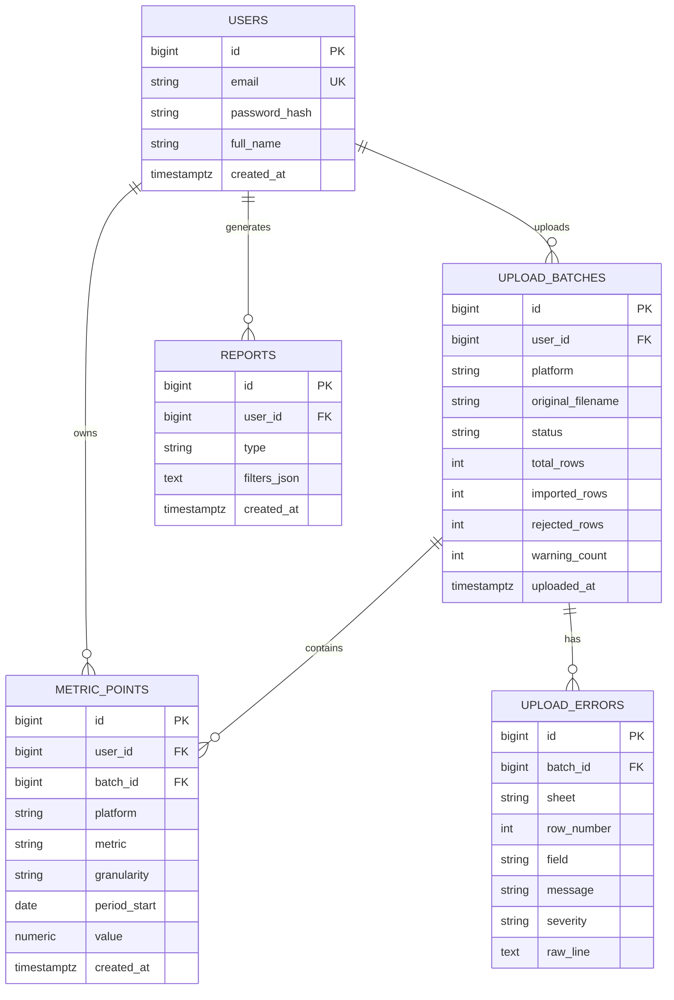

# SocialPulse ER Diyagramı (Revizyon 3)

Gün 5'te gönderi bazlı `posts` tablosu kaldırıldı, yerine hesap seviyesinde `metric_points` geldi.
Gün 9'da `upload_errors` tablosuna `sheet` ve `severity` (ERROR, WARNING), `upload_batches` tablosuna `warning_count` eklendi.

`metric_points` benzersiz kısıtı: `(user_id, platform, metric, granularity, period_start)`.
Aynı dosya tekrar yüklenirse değer ve `batch_id` güncellenir; bu yüzden eski bir yüklemeyi silmek,
sonradan aynı dönemleri güncelleyen yeni yüklemenin ölçümlerini silmez.
