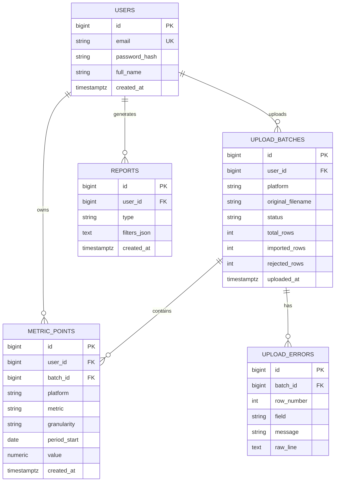

# SocialPulse ER Diyagramı (Revizyon 2)

Gün 5'te gönderi bazlı `posts` tablosu kaldırıldı, yerine hesap seviyesinde `metric_points` geldi.
`upload_errors` tablosu V1'de oluşturuldu, Gün 9'da kullanılacak.

`metric_points` benzersiz kısıtı: `(user_id, platform, metric, granularity, period_start)`.
